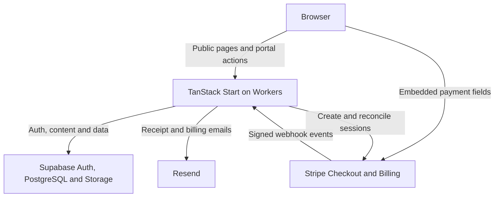

<h1 align="center">
  
</h1>

<p align="center">
  <strong>A Canadian nonprofit website, donation platform, and content management system</strong>
</p>

<p align="center">
  <a href="https://hopebeyondscarcity.com/"><strong>Visit the live site</strong></a> ·
  <a href="#stack-and-versions">Tech stack</a> ·
  <a href="#cms-and-operations">CMS</a> ·
  <a href="#privacy-and-payment-security">Privacy and payments</a> ·
  <a href="#developer">Developer</a>
</p>

## Overview

[Hope Beyond Scarcity](https://hopebeyondscarcity.com/) is a Toronto-based Canadian not-for-profit founded by Rajasree Roy and Lilibet Yang. Its programs support children and families in underserved communities, including villages in Bangladesh, through care packages, health support, education, clean water, and emergency relief.

The platform gives visitors a place to learn about the work and contribute in Canadian dollars. Donors and volunteers manage their activity in a shared portal. Staff publish stories and programs, process inquiries and applications, and monitor giving from an internal CMS.

| Audience | What they can do |
| --- | --- |
| **Visitors and sponsors** | Explore the mission, programs, campaigns, impact figures, sponsors, volunteer roles, and newsroom. Send an inquiry or give as a guest. |
| **Donors** | Give once or monthly. Sign in for donation history, downloadable PDF acknowledgements, and recurring gift controls. |
| **Volunteers** | Apply for listed roles and submit care-package pitches through the account dashboard. |
| **Staff** | Publish content, manage members and submissions, review gifts, and see site analytics. |

The website uses a blue heart-and-leaves mark, amber accents, and the Inter/Roboto type stack. This case study pairs that palette with Shahriar Nabil’s orange, pink, and violet signature mark. The self-contained banner includes the original mark as a watermark and reduces motion when the viewer requests it. [Site theme](./src/styles.css) · [Site logo](./src/assets/brand-logo.png)

## Stack and versions

Package versions below are resolved in [`bun.lock`](./bun.lock). Managed service versions and deployment settings are separate from SDK versions.

| Technology | Locked version | Role |
| --- | --- | --- |
|  **React / React DOM** | `19.2.8` each | Rendering and browser hydration |
|  **TanStack Start / Router / Query** | `1.168.60` / `1.170.41` / `5.101.4` | Full-stack server functions and SSR, file-based routing, and query state |
|  **TanStack Router plugin** | `1.168.42` | Route tree generation |
|  **TypeScript** | `5.9.3` | Application and database types |
|  **Vite / React plugin / Lightning CSS** | `8.2.0` / `5.2.0` / `1.33.0` | Development server, bundling, and CSS transformation |
|  **Tailwind CSS / Vite plugin** | `4.3.3` each | Theme tokens, responsive layouts, and utility styles |
|  **Radix Primitives / Motion** | Per primitive below / `13.1.1` | Dialogs, tabs, controls, and transitions |
|  **Lucide / Tiptap / Recharts** | `0.575.0` / `3.31.4` / `2.15.4` | UI icons, CMS rich text, and charts |
| **React Hook Form / Zod / resolvers** | `7.83.0` / `3.25.76` / `5.5.7` | Form state and input validation |
|  **Nitro / H3 / Cloudflare Workers** | `3.0.260603-beta` / `2.0.1-rc.26` / managed | Server bundling and default Worker build target |
|  **Supabase JS** | `2.112.3` | Auth, REST client, Storage, and generated database types. The bundled Auth, PostgREST, Storage, and Realtime SDK packages resolve to the same version. |
|  **PostgreSQL** | Supabase-managed | Relational schema, RLS policies, triggers, and analytics rollups. The database server version is deployment-specific. |
|  **Stripe** | Node SDK `22.0.2` · Stripe.js `9.2.0` · React binding `6.2.0` | API `2026-03-25.dahlia`, Embedded Checkout, recurring billing, billing portal, and webhook handling |
|  **Resend / pdf-lib** | HTTP API · `1.17.1` | Transactional email and downloadable PDF acknowledgements |
|  **Bun**  **Node.js** | Toolchain, not pinned | Install from the lockfile and run the Vite tooling |
|  **Vitest / ESLint / Prettier** | `5.0.3` / `9.39.5` / `3.9.6` | Tests, linting, and formatting |

<details>
<summary><strong>Complete direct dependency inventory</strong></summary>

| Package | Locked version | Scope |
| --- | --- | --- |
| `@hookform/resolvers` | `5.5.7` | Application |
| `@radix-ui/react-accordion` | `1.2.20` | Application |
| `@radix-ui/react-alert-dialog` | `1.1.23` | Application |
| `@radix-ui/react-aspect-ratio` | `1.1.15` | Application |
| `@radix-ui/react-avatar` | `1.2.6` | Application |
| `@radix-ui/react-checkbox` | `1.3.11` | Application |
| `@radix-ui/react-collapsible` | `1.1.20` | Application |
| `@radix-ui/react-context-menu` | `2.3.7` | Application |
| `@radix-ui/react-dialog` | `1.1.23` | Application |
| `@radix-ui/react-dropdown-menu` | `2.1.24` | Application |
| `@radix-ui/react-hover-card` | `1.1.23` | Application |
| `@radix-ui/react-label` | `2.1.15` | Application |
| `@radix-ui/react-menubar` | `1.1.24` | Application |
| `@radix-ui/react-navigation-menu` | `1.2.22` | Application |
| `@radix-ui/react-popover` | `1.1.23` | Application |
| `@radix-ui/react-progress` | `1.1.16` | Application |
| `@radix-ui/react-radio-group` | `1.4.7` | Application |
| `@radix-ui/react-scroll-area` | `1.2.18` | Application |
| `@radix-ui/react-select` | `2.3.7` | Application |
| `@radix-ui/react-separator` | `1.1.15` | Application |
| `@radix-ui/react-slider` | `1.4.7` | Application |
| `@radix-ui/react-slot` | `1.3.3` | Application |
| `@radix-ui/react-switch` | `1.3.7` | Application |
| `@radix-ui/react-tabs` | `1.1.21` | Application |
| `@radix-ui/react-toggle` | `1.1.18` | Application |
| `@radix-ui/react-toggle-group` | `1.1.19` | Application |
| `@radix-ui/react-tooltip` | `1.2.16` | Application |
| `@stripe/react-stripe-js` | `6.2.0` | Application |
| `@stripe/stripe-js` | `9.2.0` | Application |
| `@supabase/supabase-js` | `2.112.3` | Application |
| `@tailwindcss/vite` | `4.3.3` | Application |
| `@tanstack/react-query` | `5.101.4` | Application |
| `@tanstack/react-router` | `1.170.41` | Application |
| `@tanstack/react-start` | `1.168.60` | Application |
| `@tanstack/router-plugin` | `1.168.42` | Application |
| `@tiptap/extension-link` | `3.31.4` | Application |
| `@tiptap/react` | `3.31.4` | Application |
| `@tiptap/starter-kit` | `3.31.4` | Application |
| `class-variance-authority` | `0.7.1` | Application |
| `clsx` | `2.1.1` | Application |
| `cmdk` | `1.1.1` | Application |
| `date-fns` | `4.4.0` | Application |
| `embla-carousel-react` | `8.6.0` | Application |
| `input-otp` | `1.4.2` | Application |
| `lucide-react` | `0.575.0` | Application |
| `motion` | `13.1.1` | Application |
| `pdf-lib` | `1.17.1` | Application |
| `react` | `19.2.8` | Application |
| `react-day-picker` | `9.14.0` | Application |
| `react-dom` | `19.2.8` | Application |
| `react-hook-form` | `7.83.0` | Application |
| `react-resizable-panels` | `4.12.2` | Application |
| `recharts` | `2.15.4` | Application |
| `sonner` | `2.0.7` | Application |
| `stripe` | `22.0.2` | Application |
| `tailwind-merge` | `3.6.0` | Application |
| `tailwindcss` | `4.3.3` | Application |
| `tslib` | `2.8.1` | Application |
| `tw-animate-css` | `1.4.0` | Application |
| `vaul` | `1.1.2` | Application |
| `vite-tsconfig-paths` | `6.1.1` | Application |
| `zod` | `3.25.76` | Application |
| `@eslint/js` | `9.39.5` | Tooling |
| `@types/node` | `22.20.1` | Tooling |
| `@types/react` | `19.2.17` | Tooling |
| `@types/react-dom` | `19.2.3` | Tooling |
| `@vitejs/plugin-react` | `5.2.0` | Tooling |
| `eslint` | `9.39.5` | Tooling |
| `eslint-config-prettier` | `10.1.8` | Tooling |
| `eslint-plugin-prettier` | `5.5.6` | Tooling |
| `eslint-plugin-react-hooks` | `5.2.0` | Tooling |
| `eslint-plugin-react-refresh` | `0.4.26` | Tooling |
| `globals` | `15.15.0` | Tooling |
| `lightningcss` | `1.33.0` | Tooling |
| `nitro` | `3.0.260603-beta` | Tooling |
| `prettier` | `3.9.6` | Tooling |
| `typescript` | `5.9.3` | Tooling |
| `typescript-eslint` | `8.65.0` | Tooling |
| `vite` | `8.2.0` | Tooling |
| `vitest` | `5.0.3` | Tooling |

</details>

## Architecture

Public routes render on the server through TanStack Start. The donor portal and staff CMS use an authenticated client-rendered route group, while sensitive reads and mutations go through server functions or RLS-scoped Supabase requests. Vite and Nitro build the application for the Cloudflare Workers preset. The [server entry](./src/server.ts) wraps SSR with an HTML error fallback.



- **Data boundaries** use the publishable client for public and user-scoped queries. Authenticated server functions validate bearer claims. Staff functions verify the caller’s role before using a server-only privileged client. [Auth middleware](./src/integrations/supabase/auth-middleware.ts) · [Staff guard](./src/lib/admin.server.ts)
- **Content publishing** uses TanStack Query, SSR hydration, a public-content browser cache, and a CMS `content_version` that invalidates stale data on the next check. CMS images are served via a bucket-allowlisted media route. [Public content](./src/lib/public-content.ts) · [Cache](./src/lib/query-persist.ts) · [Media route](./src/routes/api/public/media/%24.ts)
- **Database changes and subscriptions** use PostgreSQL migrations and Stripe webhook-driven subscription updates. Supabase Realtime is available in the bundled SDK. The audited app source uses query revalidation and cross-tab cache invalidation for content updates, with no active Postgres Changes channel. [Migrations](./supabase/migrations) · [Subscription sync](./src/lib/donation-record.server.ts)

## Authentication and donor portal

| Capability | Implementation |
| --- | --- |
| **Email and password** | Sign up with name, email, password rules, and policy acceptance. If confirmation is required, enter the six-digit email code. Email/password sign-in and sign-out use Supabase Auth. |
|  **Google OAuth** | Supabase starts the Google flow and returns to `/auth`. The app checks for a registered profile and routes staff to `/admin` and donors to `/dashboard`. Provider configuration lives in Supabase. |
| **Recovery and account security** | Email recovery codes and a reset-link route, plus signed-in password changes with current-password verification. The dashboard also supports account deletion. |
| **RBAC and RLS** | Application roles `admin`, `editor`, and `donor` are recorded in PostgreSQL’s `user_roles` table. Route guards, server role checks, and row policies separate staff operations, the donor’s own records, and public content. |
|  **Turnstile** | Configurable widgets on sign-in, sign-up, recovery, and contact. Auth passes the token to Supabase. The contact UI invokes a server-side Siteverify check when configured. |
| **Self-service dashboard** | Profile and avatar, donation history and PDF downloads, recurring amount and cancellation controls, billing portal and payment retries, volunteer applications, care-package pitches, and security settings. |

[Auth pages](./src/routes/auth) · [Session and role handling](./src/hooks/use-auth.tsx) · [Dashboard](./src/routes/_authenticated/dashboard.tsx) · [Turnstile integration](./src/lib/turnstile.functions.ts)

## CMS and operations

| Area | Modules |
| --- | --- |
| **Overview and analytics** | Giving and activity summaries. Analytics by page, event, source, referrer, country, browser, and device. |
| **Pages and storytelling** | About page hero, introduction, founders, story, mission, and SEO. Program and newsroom publishing, rich-text editing, imagery, and legal pages. |
| **Community content** | Sponsors and sponsor tiers, volunteer role listings, impact figures, and partner logos. The events dataset and CMS route remain for archived content. The public events URL redirects to Sponsors. |
| **People and inbox** | Members and role administration, volunteer applications, care-package pitches, and contact messages. Administrator-only mutations include role changes and account administration. |
| **Finance** | Donations, receipt download and resend, recurring gifts, cancellation scheduling, and finance status changes with role checks. |
| **Site settings** | Homepage hero and mission, campaign spotlight, impact, partners, calls to action, emergency banner, contact, social links, and public-cache refresh. |

[CMS navigation](./src/routes/_authenticated/admin.tsx) · [Content functions](./src/lib/admin-content.functions.ts) · [People functions](./src/lib/admin-people.functions.ts) · [Finance functions](./src/lib/admin-finance.functions.ts)

## Payments and email

1. **Gift selection.** Donors choose a one-time or monthly CAD gift. The server validates the amount in integer cents and creates the Stripe Checkout Session. The browser renders Stripe’s embedded payment UI.
2. **Stripe webhook.** `POST /api/public/payments/webhook?env=sandbox` or `?env=live` checks the signature and timestamp with the matching signing secret. It handles Checkout completion and delayed payment outcomes, subscription lifecycle events, invoice payments, and failed renewals.
3. **Reconciliation.** The app upserts donations and subscriptions using Stripe identifiers. The thank-you route can retrieve the Checkout Session from Stripe and reconcile a delayed webhook. A database claim coordinates receipt sending across those two entry points.
4. **Receipts and billing.** The server generates PDF gift acknowledgements and sends them through Resend. Donors can download their own receipts and manage recurring gifts. The receipt template identifies the PDF as a gift acknowledgement rather than an official income tax receipt.

[Checkout session creation](./src/lib/donation.server.ts) · [Webhook handler](./src/routes/api/public/payments/webhook.ts) · [Receipt processing](./src/lib/donation-record.server.ts) · [Email API](./src/lib/email.server.ts)

## Analytics, SEO and edge services

| Integration | Implementation and verification |
| --- | --- |
|  **Google Analytics 4** | Browser-side `gtag.js` and Consent Mode v2. When configured and opted in, custom events include page views, engagement, scroll depth, CTA clicks, outbound links, and downloads. App-emitted events exclude CMS routes. |
|  **First-party analytics** | The same-origin `/api/public/track` route records opted-in app events in PostgreSQL. Triggers roll up daily totals and dimensions for the CMS and cap the recent raw-event buffer at 100 rows. |
|  **Google Search Console** | Public DNS publishes a Google site-verification TXT record. The live `sitemap.xml` and `robots.txt` respond over HTTPS. Property ownership and indexing reports are managed in Search Console. |
|  **Schema.org JSON-LD** | Published news detail routes generate `NewsArticle` structured data with headline, image, dates, author, and publisher. Canonicals, Open Graph, and social-card metadata accompany shareable pages. |
|  **Workers and HTTPS** | The Nitro build targets Cloudflare Workers. The public homepage, privacy page, and sitemap were reachable over HTTPS with successful TLS verification. |
|  **Bot Fight Mode** | A Cloudflare zone-level setting, separate from the app’s Turnstile integration. Its enabled state requires confirmation in the zone dashboard. |

[Analytics client](./src/lib/analytics.ts) · [Analytics ingest](./src/routes/api/public/track.ts) · [Live sitemap](https://hopebeyondscarcity.com/sitemap.xml) · [Live robots.txt](https://hopebeyondscarcity.com/robots.txt) · [News structured data](./src/routes/news.%24slug.tsx) · [Cloudflare Bot Fight Mode](https://developers.cloudflare.com/bots/get-started/bot-fight-mode/)

## Privacy and payment security

**Cookie consent.** The banner offers accept-all, reject-non-essential, and separate choices for performance, functional, advertising, and social preferences. The effective analytics permissions start denied. Performance consent gates the browser analytics script and first-party tracking calls. A versioned decision is stored locally with a 365-day window. Consent changes propagate across tabs and withdrawal clears local analytics identifiers and attempts to remove known analytics cookies. The first preference draft shows optional switches preselected before confirmation. The code provides a reopen event, with no persistent preference link wired into the current site layout. [Consent store](./src/lib/consent.ts) · [Banner](./src/components/cookie-consent.tsx)

**Canadian privacy practices.** The platform publishes its privacy, terms, and refund policies. It scopes account access through roles and RLS, limits the raw analytics event buffer, and supports deleting account data while removing direct donor identifiers from retained donation rows. Analytics records can include a pseudonymous visitor/session identifier and, for signed-in visitors, a user identifier. These controls document the implementation against relevant consent and data-handling principles. PIPEDA applicability depends on the organization’s activities, and Québec’s private-sector privacy obligations under Law 25 require a separate assessment of applicable practices and live settings. [Privacy policy](https://hopebeyondscarcity.com/privacy) · [OPC meaningful consent guidance](https://www.priv.gc.ca/en/privacy-topics/privacy-for-businesses/appropriate-handling-of-personal-information/collecting-personal-information-and-consent/consent/gl_omc_201805/) · [OPC guidance for nonprofits](https://www.priv.gc.ca/en/privacy-topics/privacy-laws-in-canada/the-personal-information-protection-and-electronic-documents-act-pipeda/r_o_p/02_05_d_19/) · [Québec private-sector privacy law](https://www.legisquebec.gouv.qc.ca/en/document/cs/p-39.1)

**PCI DSS (Payment Card Industry Data Security Standard).** Stripe-hosted payment fields keep full card numbers and security codes out of this app’s payment request and storage paths. Stripe describes its own assessment as a PCI Level 1 service provider. The organization’s merchant scope, eligibility for a self-assessment questionnaire, and validation obligations depend on the live deployment and processor requirements. [Stripe security and PCI guide](https://docs.stripe.com/security/guide) · [PCI SSC guidance for embedded payment forms](https://www.pcisecuritystandards.org/faqs/1588/)

## Local development

Install Bun and a Node.js version supported by Vite 8.2.0 (`20.19+` on Node 20, or `22.12+`).

```sh
bun install --frozen-lockfile
bun run dev
bun run build
```

Use `bun run build:dev` for a development-mode build, `bun run lint` for linting, and `bun run vitest run` for tests. The Nitro production build uses the Cloudflare Workers preset by default. [Build configuration](./vite.config.ts)

| Scope | Configuration |
| --- | --- |
| **Browser build** | `VITE_SUPABASE_URL`, `VITE_SUPABASE_PUBLISHABLE_KEY`, and a Stripe publishable key in `VITE_PAYMENTS_CLIENT_TOKEN` |
| **Optional browser analytics** | `VITE_GOOGLE_ANALYTICS_MEASUREMENT_ID` |
| **Server and database** | `SUPABASE_URL`, `SUPABASE_PUBLISHABLE_KEY`, and server-only `SUPABASE_SERVICE_ROLE_KEY` |
| **Stripe server and webhook** | `STRIPE_SANDBOX_API_KEY`, `STRIPE_LIVE_API_KEY`, `PAYMENTS_SANDBOX_WEBHOOK_SECRET`, `PAYMENTS_LIVE_WEBHOOK_SECRET` |
| **Transactional email** | `RESEND_API_KEY` with access to the verified receipt sender domain |
| **Bot verification** | `TURNSTILE_SITE_KEY` and `TURNSTILE_SECRET_KEY`. Configure the CAPTCHA provider separately for Supabase Auth. |

Keep secrets in the hosting environment. Match the Stripe publishable key, server key, and webhook secret to the same Stripe environment. Verify checkout, signed webhook delivery, and receipt email in the sandbox before switching a live deployment.

## Developer

<p>
  <a href="https://shahnabil.com/"></a>
</p>

**Shahriar Nabil** · Developer contact

[shahnabil.com](https://shahnabil.com/) · [hello@shahnabil.com](mailto:hello@shahnabil.com) · [Call +8801790736863](tel:+8801790736863) · <a href="https://wa.me/8801790736863"> WhatsApp</a>

<sub>Technology marks are from <a href="https://simpleicons.org/">Simple Icons</a>. The JSON-LD mark is from the <a href="https://json-ld.org/images/">JSON-LD project</a>. Marks identify the technologies used in this case study.</sub>
